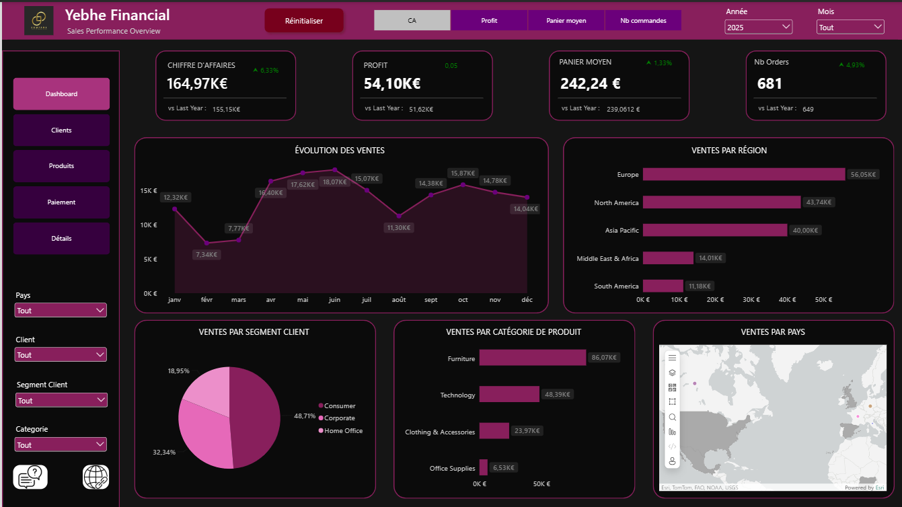
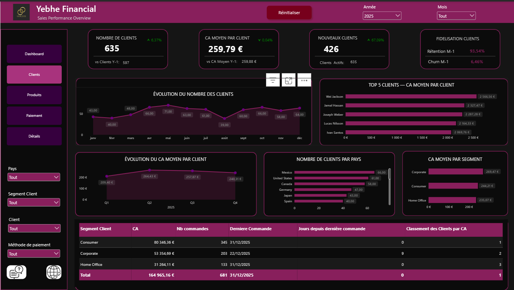
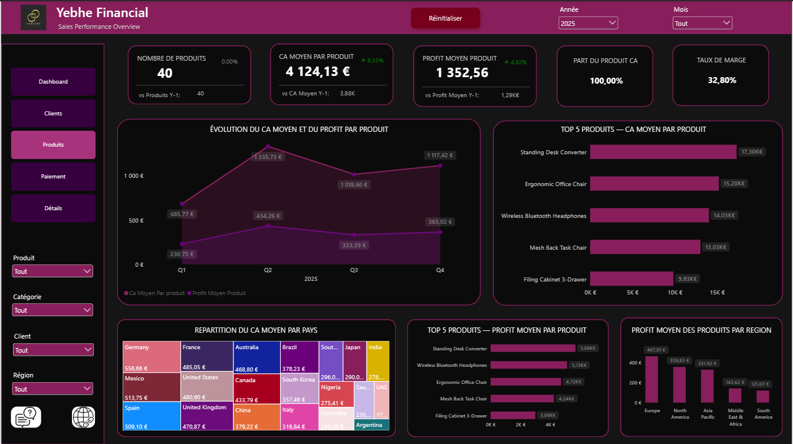
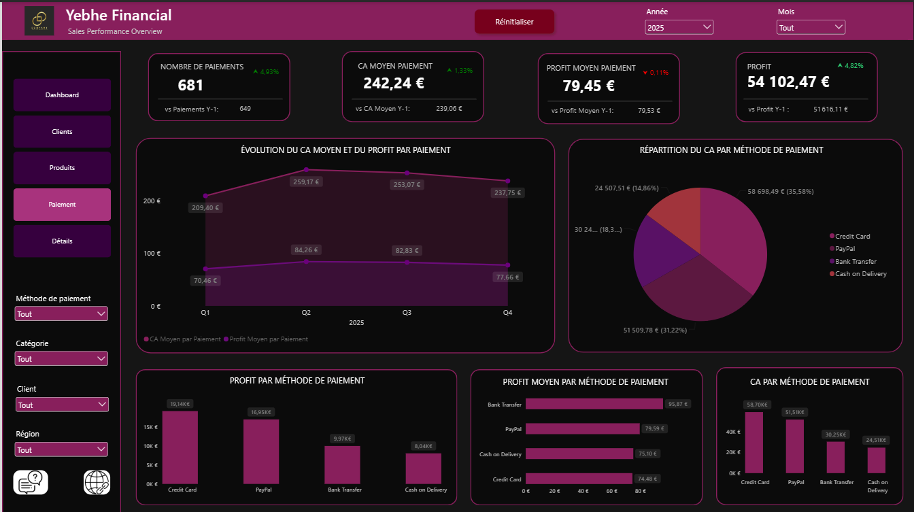
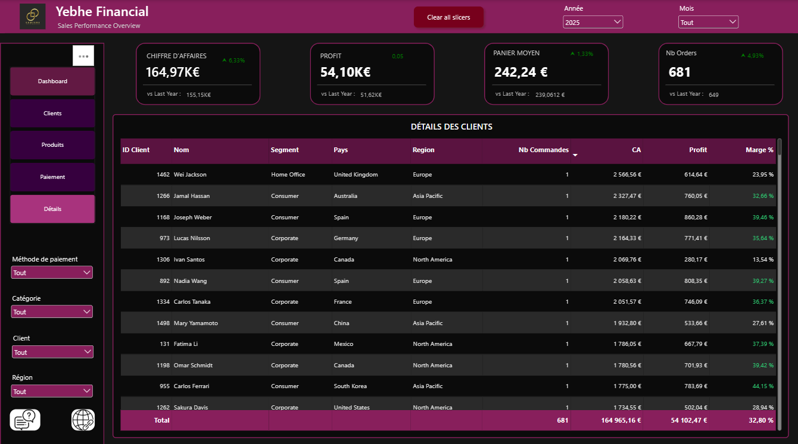
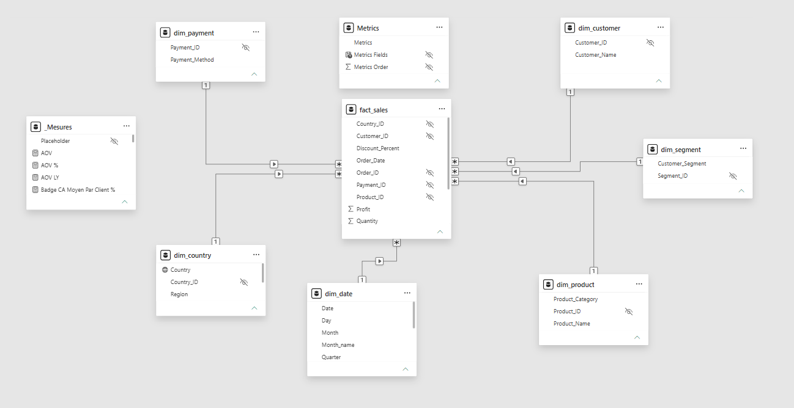
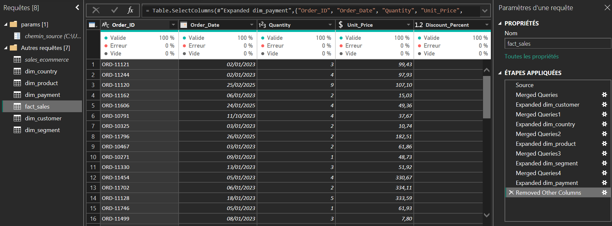
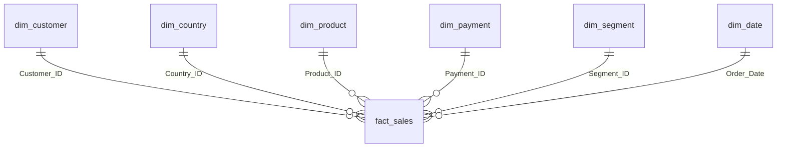

<div align="center">

# 🛒 E-commerce – Pilotage des ventes

**Tableau de bord Power BI de suivi de la performance commerciale**
Chiffre d'affaires · Profit · Panier moyen · Clients · Produits · Paiements


<br>

[](https://github.com/yebhe/ecommerce-powerbi/raw/refs/heads/main/yebhe_financial_last.pbix)
[](data/)
[](measures/mesures_dax.md)
[](sql/)
[](docs/README.md)
[](https://www.linkedin.com/in/yebhe/)

</div>

> ⚠️ **Projet d'apprentissage.** Les données sont fictives et ne représentent aucune entreprise réelle (voir [Limites connues](#-limites-connues)).

---

## 📑 Sommaire

1. [Aperçu du rapport](#-aperçu-du-rapport)
2. [Objectif](#-objectif)
3. [Source des données](#-source-des-données)
4. [Modèle de données](#-modèle-de-données)
5. [Mesures DAX](#-mesures-dax)
6. [Contrôles qualité](#-contrôles-qualité)
7. [Compétences démontrées](#-compétences-démontrées)
8. [Ouvrir le projet](#-ouvrir-le-projet)
9. [Limites connues](#-limites-connues)
10. [Pistes d'amélioration](#-pistes-damélioration)
11. [Structure du dépôt](#-structure-du-dépôt)
12. [Auteur](#-auteur)

---

## 📸 Aperçu du rapport

### Page de synthèse



### Pages thématiques

| Clients | Produits |
|:---:|:---:|
|  |  |
| **Paiement** | **Détails** |
|  |  |

### Modèle relationnel



---

## 🎯 Objectif

Donner une vue unique de l'activité d'un site e-commerce : ventes, rentabilité, fidélisation des clients et poids des produits, des régions et des moyens de paiement.

| Domaine | Questions auxquelles le rapport répond |
|---|---|
| 💰 **Ventes** | Quel chiffre d'affaires, quel profit, quel panier moyen, combien de commandes ? |
| 👥 **Clients** | Combien de clients, combien de nouveaux, quels taux de rétention et de churn ? |
| 📦 **Produits** | Combien de produits vendus, quel CA et quel profit moyen par produit, quel taux de marge ? |
| 💳 **Paiements** | Quelle répartition des méthodes de paiement, quel CA et quel profit moyen par méthode ? |
| 🔎 **Détails** | Qui sont les clients : segment, pays, nombre de commandes, CA, profit et marge ? |

Chaque indicateur est comparé à la **même période de l'année précédente (N-1)**. Un sélecteur de métrique (*CA · Profit · Panier moyen · Nb commandes*, table `Metrics`) pilote les graphiques et les titres dynamiques du dashboard.

### Quelques repères (sans filtre, 2023–2025)

| Indicateur | Valeur |
|---|---:|
| Commandes / clients / produits | 2 000 / 1 534 / 40 |
| Pays / régions | 20 / 5 |
| Chiffre d'affaires / profit / taux de marge | 484 559 € / 158 872 € / 32,8 % |
| Frais de port / articles vendus | 25 804 € / 7 115 |
| CA par année | 164 443 € (2023) · 155 151 € (2024) · 164 965 € (2025) |
| Segment principal | Consumer, 256 288 € (52,9 % du CA) |
| Catégorie principale | Furniture, 256 275 € (52,9 % du CA) |
| Région principale | Europe, 137 006 € (28,3 % du CA) |
| Méthode de paiement principale | Credit Card, 192 718 € (39,8 % du CA) |

### Ce que montrent les données

- **Creux 2024 puis rebond** : le CA recule de 5,7 % en 2024 puis repart de +6,3 % en 2025, à peu près au niveau de 2023.
- **La moitié du CA vient d'un seul segment et d'une seule catégorie** : Consumer et Furniture pèsent chacun ~53 % des ventes.
- **Forte concentration géographique** : Europe, North America et Asia Pacific réalisent ~81 % du CA ; South America et Middle East & Africa ~9,5 % chacune.
- **Fidélisation fragile** : 1 142 clients sur 1 534 (74 %) n'ont passé qu'une seule commande sur trois ans ; en 2025, le rapport affiche 426 nouveaux clients, une rétention mensuelle de 93,5 % et un churn de 6,5 %.
- **Des ventes à perte** : 272 commandes (13,6 %) dégagent un profit négatif, vraisemblablement sous l'effet des remises (jusqu'à 30 %) et des frais de port.

---

## 📊 Source des données

Un fichier plat, **global_ecommerce_sales.csv** (2 000 lignes, une ligne par commande), chargé par Power Query puis éclaté en 1 table de faits et 5 dimensions, auxquelles s'ajoutent le calendrier calculé `dim_date` et le paramètre de champ `Metrics`. Jeu de données fictif à vocation pédagogique. Période couverte : **02/01/2023 au 31/12/2025** (3 années complètes).

| Colonne | Contenu |
|---|---|
| `Order_ID` | Identifiant de commande (unique, texte) |
| `Order_Date` | Date de commande |
| `Customer_Name`, `Customer_Segment` | Client et segment (Consumer, Corporate, Home Office) |
| `Country`, `Region` | Pays (20) et région (5) |
| `Product_Category`, `Product_Name` | Catégorie (4) et produit (40) |
| `Quantity`, `Unit_Price`, `Discount_Percent` | Quantité (1–15), prix unitaire, remise (0–30 %) |
| `Total_Sales`, `Shipping_Cost`, `Profit` | Montants de la commande |
| `Payment_Method` | Méthode de paiement (4) |

Power Query : une requête source `sales_ecommerce` (typage des colonnes, montants convertis avec la locale **en-US**), une requête par dimension (colonne sélectionnée, doublons supprimés, clé d'index ajoutée), puis fusion de ces dimensions dans la table de faits pour récupérer les clés (`Table.NestedJoin` en LeftOuter). Le chemin du dossier `data` est porté par le paramètre `chemin_source`.



---

## 🧱 Modèle de données

Modèle en étoile, mode Import, culture fr-FR : **1 fait**, **5 dimensions**, le calendrier calculé `dim_date`, **6 relations** plusieurs-à-un (filtrage unidirectionnel), toutes actives.




### Tables

| Table | Rôle (une ligne =) | Lignes |
|---|---|---:|
| `fact_sales` | une commande (date, quantité, prix, remise, montants) | 2 000 |
| `dim_customer` | un client | 1 534 |
| `dim_country` | un pays et sa région | 20 |
| `dim_product` | un produit et sa catégorie | 40 |
| `dim_payment` | une méthode de paiement | 4 |
| `dim_segment` | un segment client | 3 |
| `dim_date` | un jour, sans trou, entre la 1ʳᵉ et la dernière commande | 1 095 |
| `Metrics` | paramètre de champ : CA, Profit, Panier moyen, Nb commandes | 4 |
| `_Mesures` | table dédiée aux 98 mesures DAX | – |

`dim_date` est une table calculée : `ADDCOLUMNS(CALENDAR(MIN(fact_sales[Order_Date]), MAX(fact_sales[Order_Date])), …)` — elle se reconstruit à chaque actualisation et couvre toujours l'intégralité des ventes. `Metrics` est un paramètre de champ (`NAMEOF` sur les 4 mesures) qui pilote le sélecteur de métrique du dashboard et les 5 titres dynamiques.

---

## 🧮 Mesures DAX

**98 mesures**, toutes dans `_Mesures`, rangées en dossiers d'affichage (`Dashboard`, `Customers`, `Products`, `Payments\kpi1-3`). Les indicateurs suivent quatre niveaux :

| Niveau | Contenu | Exemple |
|---|---|---|
| **1. Base** | L'indicateur lui-même | `CA`, `Nb Orders`, `Nb Clients` |
| **2. Comparaison N-1** | Même période l'année précédente (`LY`) et variation (`%`) | `CA LY`, `CA YOY %` |
| **3. Affichage** | Texte formaté avec flèche ▲ ▼ • et « — » si vide | `CA YOY Format`, `Profit YOY Affichage` |
| **4. Couleur (CF)** | `green` / `red` / `grey` ou code hexadécimal pour la mise en forme conditionnelle | `CF CA`, `Profit YOY CF` |

| Mesure | Définition |
|---|---|
| `CA` / `Profit` / `Shipping cost` | `SUM` des montants de `fact_sales` |
| `Nb Orders` / `Nb Clients` / `Nb Products` | `DISTINCTCOUNT` des clés de la table de faits |
| `AOV` (panier moyen) | `DIVIDE([CA], [Nb Orders])` |
| `*_LY` | `CALCULATE([…], SAMEPERIODLASTYEAR(dim_date[Date]))` |
| `Nb Clients Retenu` / `Nb Clients Churn` | clients communs au mois courant et au mois précédent (`INTERSECT` / `EXCEPT` + `DATEADD(-1, MONTH)`) |
| `Taux de Retention %` / `Taux de Churn %` | rapport au nombre de clients du mois précédent |
| `Nb Nouveaux Clients` | clients dont la 1ʳᵉ commande tombe dans la période filtrée |
| `Jours depuis dernière commande` | écart entre la dernière commande du client et la date max du jeu |
| `Statut Client` | Actif / À surveiller (> 10 j) / À risque (> 20 j) / Inactif |
| `Classement des Clients par CA` | `RANKX(ALLSELECTED(dim_customer[Customer_Name]), [CA])` |
| `Taux de Marge %` | `DIVIDE([Profit], [CA])` |
| `Part du produit CA` | CA du produit / CA tous produits (`ALL(dim_product)`) |
| `Dynamic Title …` (× 5) | titre du graphique selon la métrique choisie dans `Metrics` |

👉 Détail des mesures de base : [`measures/mesures_dax.md`](measures/mesures_dax.md)

---

## ✅ Contrôles qualité

Contrôles réalisés en lecture seule sur le fichier source et le modèle chargé. Aucune anomalie bloquante relevée.

| Domaine | Contrôle | Résultat |
|---|---|---|
| Clés | unicité de `Order_ID` | 2 000 lignes, 2 000 identifiants distincts |
| Complétude | valeurs vides dans les 15 colonnes | 0 |
| Cohérence | `Total_Sales` = `Quantity` × `Unit_Price` × (1 − remise) | exact sur 2 000 lignes |
| Plausibilité | `Profit` ≤ `Total_Sales`, `Shipping_Cost` ≥ 0 | 0 violation |
| Plausibilité | commandes à profit négatif | 272 (13,6 %) — ventes à perte, conservées |
| Dates | calendrier calculé couvrant toutes les commandes | 02/01/2023 au 31/12/2025 |

---

## 🧠 Compétences démontrées

| Domaine | Détail |
|---|---|
| **Import et nettoyage (Power Query)** | Éclatement d'un fichier plat en faits et dimensions, clés d'index, fusions, paramètre de chemin |
| **Modélisation** | Étoile : 1 fait, 5 dimensions, calendrier calculé, paramètre de champ |
| **DAX** | 98 mesures : N-1, rétention / churn / nouveaux clients, marge, RANKX, textes et couleurs conditionnels, titres dynamiques |
| **Qualité des données** | Contrôles de clés, de complétude et de cohérence, limites documentées |
| **Visualisation** | Dashboard piloté par paramètre de champ + 4 pages thématiques, navigation par onglets |
| **Qualité du modèle** | Table de mesures dédiée, dossiers d'affichage, clés techniques masquées |
| **SQL** | Indicateurs du rapport reproduits en SQL : agrégats, `LAG` (N-1), `RANK`, rétention/churn par auto-jointure, contrôles qualité |
| **Documentation** | README, schéma du modèle, limites chiffrées |

---

## 🚀 Ouvrir le projet

1. Ouvrir le fichier `yebhe_financial_last.pbix` dans **Power BI Desktop**.
2. **Accueil → Transformer les données → Paramètres de la source de données** (ou **Gérer les paramètres**), puis renseigner `chemin_source` avec le chemin **du dossier** `data` (sans le nom du fichier).
   Exemple : `C:\projets\ecom_p1_last\data`
3. Cliquer sur **Actualiser**.
4. Contrôler : 2 000 commandes dans `fact_sales`, 98 mesures dans `_Mesures`, CA total ≈ 484 559 €.

---

## 🚧 Limites connues

- **Données fictives.** Jeu de démonstration : les clients, montants et répartitions ne représentent aucune entreprise réelle.
- **Devise d'affichage.** Les montants sont affichés en euros alors que la source ne précise pas de devise (montants parsés en locale en-US pour le point décimal).
- **Rétention et churn mensuels.** `Nb Clients Retenu` / `Churn` comparent chaque mois au mois précédent (`DATEADD(-1, MONTH)`) : un client absent un mois puis de retour compte comme churné puis nouveau. Ce n'est pas un churn annualisé.
- **« Jours depuis dernière commande »** est mesuré par rapport à la date maximale du jeu (31/12/2025), pas à aujourd'hui : l'indicateur et le `Statut Client` qui en dépend ne vieillissent pas.
- **Classement des clients.** `Classement des Clients par CA` classe le contexte courant parmi les clients : affiché au niveau segment ou région, il vaut 1 partout (le total du segment dépasse celui de chaque client). Il n'est correct que dans un visuel listant les clients.
- **Clés de dimension positionnelles.** `Country_ID`, `Product_ID`, etc. sont des index Power Query basés sur l'ordre de première apparition : ils peuvent changer si la source évolue, ce qui invaliderait les repères internes (sans impact sur les mesures).
- **Trois années seulement.** Les comparaisons N-1 de 2023 sont vides par construction (pas de 2022), d'où l'affichage « — ».

---

## 🔭 Pistes d'amélioration

- Factoriser le motif `LY` / `%` / `Affichage` / `CF` — recopié sur ~70 mesures — dans un **groupe de calcul** (calculation group).
- Centraliser les couleurs écrites en dur (`"green"`, `"#2ECC71"`, `"#E74C3C"`, `"#9A9A9A"`) dans des mesures techniques, comme dans le projet RH.
- Rendre le classement sensible à la granularité (`ISINSCOPE`) ou décliner `Classement des Segments par CA`.
- Creuser les **272 commandes à perte** : par catégorie, remise et région, avec un seuil d'alerte sur la marge.
- Ajouter la **sécurité au niveau des lignes** (RLS) par région pour un usage multi-équipes.
- Remplacer la date de référence « date max du jeu » par une bascule paramétrable pour que les statuts clients restent pertinents dans le temps.

---

## 📂 Structure du dépôt

```
ecom_p1_last/
├── README.md                     ← ce fichier
├── .gitignore
├── yebhe_financial_last.pbix     ← rapport Power BI
├── data/
│   ├── README.md                 ← description des données
│   └── global_ecommerce_sales.csv ← fichier source
├── docs/
│   ├── README.md
│   └── *.png                     ← captures du rapport et du modèle
├── measures/
│   └── mesures_dax.md            ← mesures DAX documentées
└── sql/
    ├── README.md                 ← prérequis et dialecte
    └── *.sql                     ← les mêmes indicateurs en SQL
```

---

## 👤 Auteur

**MAMADOU Lamarana Diallo** · [LinkedIn](https://www.linkedin.com/in/yebhe/)
